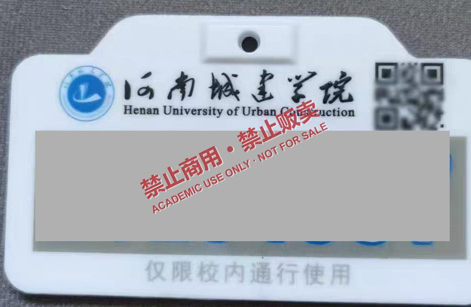

# UHF RFID 电子号牌的标识模型与可复制性研究

> 以校园电动自行车数字化号牌（915 MHz 无源 UHF EPC Gen2）为对象的应用安全研究。
>
> **严禁商用 · 严禁贩卖 · 严禁用于任何未获授权的门禁通行**



*图 1　号牌实物（号码区域已遮挡，二维码已模糊，全部图像带禁止商用/贩卖水印）*

---

## 一、项目简介

本项目讨论一个问题：**当校园门禁仅以标签 EPC 作为身份判据时，号牌在标签层能否被"快速、正确、可重复"地复制，以及为什么。**

研究对象是常见的无源超高频（UHF, 860–960 MHz）电子号牌，遵循 ISO/IEC 18000-63（EPC Class-1 Generation-2）协议。报告从物理层、协议层、存储模型、系统判定逻辑四个层面拆解标识的构成，提出 **L1/L2/L3 三级克隆模型**，并给出对应的防御建议与自评估清单。

研究定位为**防御性安全评估**：先证明风险存在，再指出最经济的阻断方式。

## 二、核心结论

| # | 结论 |
| --- | --- |
| 1 | 号牌标签符合 Gen2 标准结构，`CRC-16` + `PC` + EPC 三段自洽，可被通用读写器完整读取 |
| 2 | 同规格空白标签的 EPC 区可写，写入后回读一致——标签层"快速且正确"的复制在工程上可行 |
| 3 | 复制标签的 TID 与原标签不同，因此 **EPC + TID 联合校验**可使最低成本的克隆失效 |
| 4 | 根因不是射频技术缺陷，而是 Gen2 不提供密码学认证 + 系统侧单因子判定 |

最经济有效的两条防护：**发卡后 PermaLock(EPC)** 与 **EPC+TID 双因子绑定**。

## 三、研究边界（重要）

**本文讨论**：标识字段能否被快速、正确地转移并保持一致；标签内存结构与一致性判定；可复制性的成因与系统级防护。

**本文不讨论、不提供**：数据保存与持久化方案；任何真实标签数据（EPC/TID/口令）；后台系统入侵方法；号牌制版与印刷资料；任何可用于非授权通行的成品方案。

文中所有照片均已裁剪去电商商品页界面，号牌号码做实色遮挡，二维码模糊，统一叠加禁止商用/贩卖水印。

## 四、文件说明

| 文件 | 说明 |
| --- | --- |
| `UHF-RFID电子号牌标识模型与可复制性研究_v1.2.md` | 完整版源文档（Markdown） |
| `UHF-RFID电子号牌标识模型与可复制性研究_v1.2.docx` | 完整版 Word（21 页，含封面/页眉页脚/表格样式） |
| `UHF-RFID电子号牌标识模型与可复制性研究_v1.2.pdf` | 完整版 PDF |
| `UHF-RFID电子号牌可复制性研究_精简版_v1.2.docx` | 精简版 Word（4 页） |
| `UHF-RFID电子号牌可复制性研究_精简版_v1.2.pdf` | 精简版 PDF |
| `images/` | 正文图 1–4（已裁剪、脱敏、加水印） |
| `精简版_图片/` | 精简版逐页图片（PNG 200 dpi + JPG） |

```
.
├── README.md
├── LICENSE
├── UHF-RFID电子号牌标识模型与可复制性研究_v1.2.md
├── UHF-RFID电子号牌标识模型与可复制性研究_v1.2.docx
├── UHF-RFID电子号牌标识模型与可复制性研究_v1.2.pdf
├── UHF-RFID电子号牌可复制性研究_精简版_v1.2.docx
├── UHF-RFID电子号牌可复制性研究_精简版_v1.2.pdf
├── images/
│   ├── fig1-eplate.jpg
│   ├── fig2-usb-reader.jpg
│   ├── fig3-blank-card.jpg
│   └── fig4-uhf-module.jpg
└── 精简版_图片/
    ├── 精简版_第1页.png / .jpg
    ├── 精简版_第2页.png / .jpg
    ├── 精简版_第3页.png / .jpg
    └── 精简版_第4页.png / .jpg
```

## 五、阅读建议

- 只想看结论：`精简版 PDF`（4 页）
- 需要完整论证与实验设计：`完整版 PDF`（21 页）
- 需要引用或二次排版：`完整版 Markdown` 或 `Word`

## 六、免责声明

> **严禁商用 · 严禁贩卖 · 严禁未授权通行**
>
> 本项目为学术研究与防御性安全评估，仅供高校后勤、信息化管理部门、安防厂商及研究人员参考。
>
> 文中不包含任何真实号牌的 EPC、TID、密钥、口令或可复现的通行凭证，也不提供任何可用于非授权通行的操作步骤。读者不得将本文内容用于任何侵犯他人权益、规避门禁管理或违反法律法规的用途。
>
> 使用本项目内容所造成的任何后果，由使用者自行承担。

## 七、许可证

本项目文档、图像与衍生文件采用 [CC BY-NC-ND 4.0](https://creativecommons.org/licenses/by-nc-nd/4.0/)（署名—非商业性使用—禁止演绎 4.0 国际）许可。

- **署名**：转载或引用请注明来源与本仓库地址
- **非商业性使用**：不得用于任何商业目的，**禁止贩卖**
- **禁止演绎**：不得修改后发布

## 八、参与与致谢

| 角色 | 标识 |
| --- | --- |
| 申请人 / 主要研究 | 匿名（Anonymous） |
| 共同研究 | 匿名（Anonymous） |
| 学术讨论与技术支持 | 匿名学术讨论组（Anonymous Contributors） |

> 科学无罪 · 数据无罪 · 开源无罪
