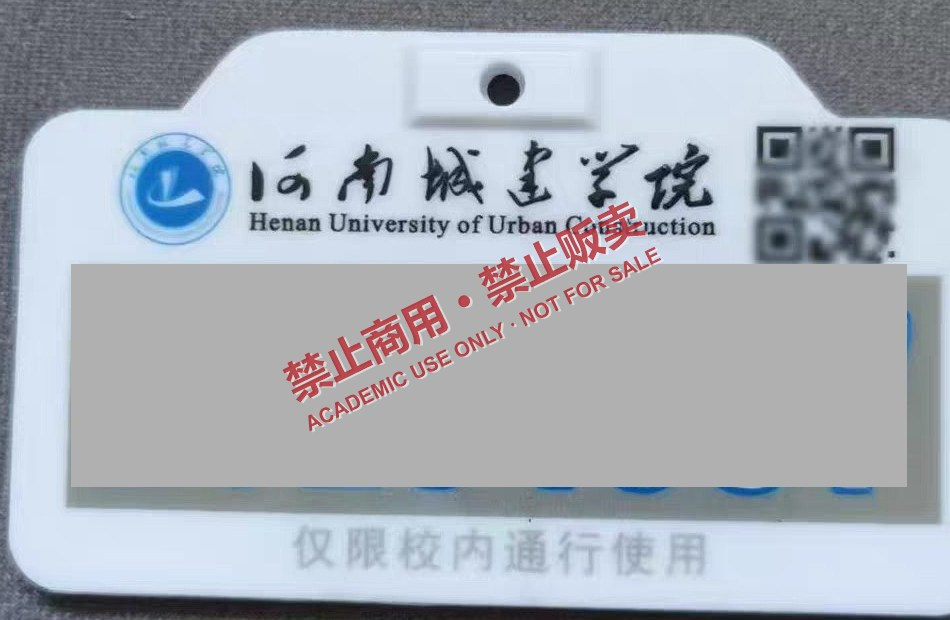
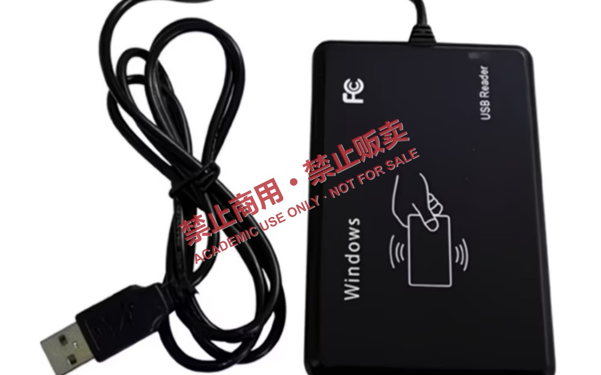
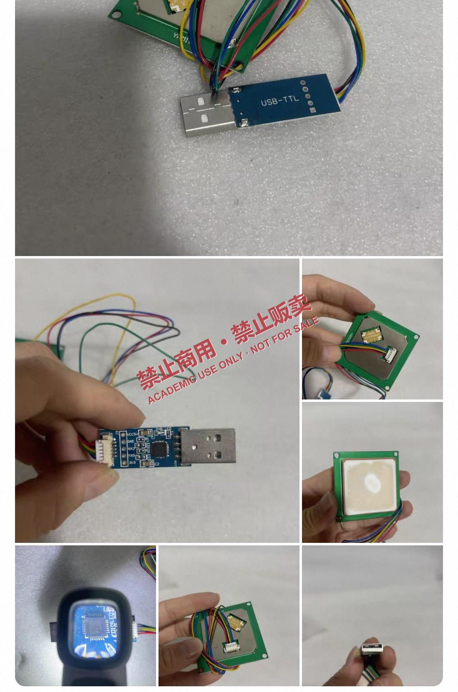

# 超高频 RFID 电子号牌的标识模型与可复制性研究

### ——以校园电动自行车数字化号牌为例

> **严禁商用 · 严禁贩卖 · 严禁用于任何未获授权的门禁通行**
>
> 本文为**学术研究与防御性安全评估**文档。文中涉及的全部标签数据均已脱敏，不包含任何真实号牌的 EPC、TID、用户区数据、密钥或可复现的通行凭证。任何组织或个人不得将本文内容用于商业销售、产品包装、批量复制、代办上牌、二手号牌交易或其他营利性用途。

***

| 项目          | 内容                                                               |
| ----------- | ---------------------------------------------------------------- |
| 文档编号        | RFID-EPLATE-2026-11-06                                           |
| 版本          | v1.2（技术细节扩充 · 图像裁剪与匿名化）                                                    |
| 研究类型        | 应用安全研究 / 射频识别技术分析（非侵入式、标签层）                                      |
| 申请人 / 主要研究者 | **匿名（Anonymous）**                                                           |
| 共同研究者       | **匿名（Anonymous）**                                                        |
| 致谢与参与讨论     | **匿名学术讨论组（Anonymous Contributors）**                               |
| 完成日期        | 2026-11-06                                                       |
| 开源地址        | `https://github.com/********/********` |
| 建议许可        | CC BY-NC-ND 4.0（署名—非商业性使用—禁止演绎）                                  |

***

## 摘要

本文以某高校正在使用的电动自行车数字化号牌为研究对象，分析其射频识别（RFID）标识模型、空中接口协议与系统判定逻辑，并讨论"标识字段可复制性"这一安全属性。研究基于**无源超高频（UHF, 860–960 MHz）EPC Class-1 Generation-2（以下简称 Gen2）** 体系展开，通过对号牌标签内存分区（Reserved / EPC / TID / User）的逐区读取、协议一致性校验，以及在**同规格空白标签**上的写入与回读比对，给出一套可在受控条件下复现的标签层研究方法。

研究结论表明：当且仅当门禁系统**以 EPC 区作为唯一身份判据**、且所用标签未启用密码学认证时，标签层身份字段的复制在工程上属于"低门槛、低成本、高一致性"的操作；其根本原因不是射频技术的缺陷，而是 **Gen2 协议本身不提供标签与读写器之间的密码学认证**，以及系统侧缺少多因子核验。本文进一步给出分级克隆模型（L1/L2/L3）、威胁模型、风险矩阵与纵深防御建议。

本文**不涉及**：数据的持久化存储方案、任何真实号牌数据的采集与共享、后台系统的入侵方法，以及可直接用于非授权通行的成品方案。

**关键词**：UHF RFID；EPC Gen2；ISO/IEC 18000-63；电子号牌；标签克隆；访问控制；防御性安全

***

## 0 研究边界与合规声明

### 0.1 本文讨论什么

本文的核心命题只有一句：

> **电动自行车数字号牌中的射频标识字段，能否以快速、正确、可重复的方式从一张标签转移到另一张标签上，并保持数据一致性？**

围绕该命题，本文讨论：射频原理、协议帧结构、标签内存模型、读写方法学、一致性判定指标、可复制性的成因与边界。这一命题在学术上属于 **RFID 标签唯一性与克隆可行性（tag cloning）** 的经典研究范畴，具有明确的安全评测价值。

### 0.2 本文不讨论什么

为避免误用，以下内容**明确排除**在本文范围之外：

1. **不讨论数据的保存与持久化**：不涉及数据库、云端同步、批量刷写流水线、跨设备分发等任何存储与分发机制。
2. **不分享任何数据**：不提供、不还原、不推测任何真实号牌的 EPC、TID、User 区内容、访问密码（Access Password）或灭活密码（Kill Password）。
3. **不提供可直接使用的通行凭证**：不提供任何可用于实际开门的成品配置、脚本参数或目标系统的判定细节。
4. **不涉及后端与网络**：不讨论平台接口、数据库注入、越权访问等应用层攻击。
5. **不提供视觉制版资料**：不提供号牌版面、二维码内容、防伪要素的制版文件或印刷参数。

### 0.3 数据处理与脱敏

本文的全部照片均经过二次处理：号牌号码区域使用实色块完全遮挡，二维码区域模糊化，见 [图 1](#fig1)。所有图像统一叠加"禁止商用 · 禁止贩卖"水印，用以声明非商业属性并防止图片被二次贩卖。设备类图像已裁去电商平台的商品页界面，仅保留设备本体，不含店铺名称、价格、销量、用户昵称等信息。

### 0.4 法律与伦理提示

- **《中华人民共和国无线电管理条例》**：UHF RFID 读写器的发射功率、频段须符合国家规定，擅自超功率、超频段发射属违法行为。

- **《中华人民共和国治安管理处罚法》《中华人民共和国刑法》**（第二百八十条之一、第二百八十五条、第二百八十六条等）：伪造、变造、买卖证明文件，非法获取或破坏计算机信息系统，均可能承担行政或刑事责任。**复制他人物权凭证并用于通行，可能构成违法。**

- **校方管理规定**：号牌为学校发放的通行凭证，其所有权与使用权归发放方；转借、复制、冒用通常被明令禁止。

**研究伦理约束**：本文所述方法仅在以下前提成立时才具备正当性——实验对象为**研究者本人持有的号牌**与**未写入的空白标签**；任何涉及门禁通行的行为验证，必须在**管理方书面授权并现场见证**的条件下进行，且不得形成可重复使用的通行能力。本文所记录的全部结论停留在**标签层读写一致性**，不延伸至通行效果。

### 0.5 开源原则

科学无罪、数据无罪、开源无罪。本项目开源的目标是**方法学可复现、结论可证伪**，而非提供工具。仓库中不包含真实标签数据、不包含目标系统配置、不包含任何绕过手段。转载、引用请保留完整免责声明与署名。

***

## 1 引言

### 1.1 背景

随着电动自行车保有量快速增长，校园、园区与社区普遍采用"数字化号牌 + 射频识别"的方式实现车辆身份登记与出入口管理。相比传统金属号牌，内置无源 UHF 标签的号牌具备三大工程优势：**远距离、非接触、可批量盘点**——车辆无需停车刷卡，读写器在 3–8 m 范围内即可完成识读，显著提升早晚高峰的通行效率。

但工程便利性与安全性之间存在天然张力：**识读距离越远，意味着标签越容易被非授权设备读取；而 Gen2 标签的标识区在多数商用芯片上默认可写**。这一组合使得"标识字段复制"在物理层和协议层都不存在硬性障碍。

### 1.2 研究问题

本文聚焦三个递进问题：

- **Q1（可行性）**：号牌标签的标识字段能否被完整读取并被写入到同规格空白标签？

- **Q2（一致性）**：复制后的标签在字段长度、校验、协议参数上与原标签是否等价？等价性的判定指标是什么？

- **Q3（安全性）**：这种等价性为何足以影响门禁判定？应当如何在系统层面阻断？

### 1.3 主要贡献

1. 给出面向电子号牌的 **四区内存分析框架**，明确"哪一区可写、哪一区不可写、哪一区才是系统真正信任的"。
2. 提出 **L1/L2/L3 三级克隆模型**，把"能复制"这一模糊表述拆解为可分级、可度量的技术结论。
3. 给出 **一致性判定指标**（长度、PC 字、CRC-16、回读一致性、识读距离偏移），使实验可复现、可证伪。
4. 提出 **标签层—读写器层—平台层—物理层—管理层** 五层防御建议与评估清单。

***

## 2 技术背景

### 2.1 无源 UHF RFID 的工作原理

无源（Passive）标签自身不含电池，其能量全部来自读写器发射的连续波（CW）。工作过程可拆为四步：

1. **供能**：读写器以 CW 照射标签，标签天线接收射频能量，经整流后为芯片供电，建立内部电压。
2. **下行调制**：读写器对 CW 进行幅度调制（ASK），以脉冲间隔编码（PIE）向标签发送命令。
3. **上行反向散射**：标签通过**改变芯片输入阻抗**，使天线反射系数在两种状态间切换，从而对反射波进行调制（ASK/PSK），把数据"反射"回读写器。
4. **解调与判定**：读写器分离出微弱的反向散射信号（典型可达 −80 dBm 量级），解调后交由协议栈处理。

因此，UHF RFID 的本质是**雷达式后向散射通信**，而非传统意义上的"发射机"。其最大识读距离可由雷达方程近似描述：

$$
P_r=\frac{P_t G_t G_r \lambda^2 \sigma}{(4\pi)^3 R^4}
\;\Longrightarrow\;
R_{\max}=\left[\frac{P_t G_t G_r \lambda^2 \sigma}{(4\pi)^3 P_{\min}}\right]^{1/4}
$$

其中 $P_t$ 为读写器发射功率，$G_t$、$G_r$ 为收发天线增益，$\lambda$ 为波长（920 MHz 时约 0.326 m），$\sigma$ 为标签雷达散射截面，$P_{\min}$ 为接收灵敏度。工程上，无源标签的识读距离主要受**标签启振功率**（typ. −20 \~ −24 dBm）与**读写器灵敏度**共同约束，在 2 W ERP 条件下典型值为 3–10 m，高灵敏度芯片可更远。这一物理特性解释了为何号牌可以在车辆不停车的情况下被识读。

### 2.2 空中接口协议

本类号牌遵循 **ISO/IEC 18000-63**（与 EPCglobal Class-1 Gen2 互通）体系，关键协议要素如下：

| 协议要素       | 典型取值 / 机制                                                | 安全含义      |
| ---------- | -------------------------------------------------------- | --------- |
| 下行编码       | PIE（Pulse Interval Encoding）                             | 无加密，明文广播  |
| 下行调制       | DSB-ASK / SSB-ASK / PR-ASK                               | 可被旁观设备接收  |
| Tari       | 6.25 / 12.5 / 25 µs                                      | 公开参数      |
| 上行编码       | FM0 或 Miller（M=2/4/8）                                    | 副载波调制，抗干扰 |
| 反向链路频率 BLF | 40–640 kHz                                               | 公开参数      |
| 防碰撞        | 时隙 ALOHA + 自适应 Q 算法                                      | 一次可盘点多标签  |
| 会话         | S0 / S1 / S2 / S3（A/B 状态）                                | 影响重复盘点行为  |
| 命令集        | Select / Inventory / Access / Read / Write / Lock / Kill | **无认证握手** |

其中最关键的一点是：**Gen2 的 Inventory 与 Read 命令不需要任何身份认证**。任何符合协议的读写器只要在物理范围内，即可向标签发起盘点和读取；标签无法区分"合法读写器"与"旁观者"。这是 UHF RFID 在隐私与克隆问题上的结构性根源。

### 2.3 标签内存模型：四个分区

Gen2 标签的逻辑内存被划分为四个区，这是理解"可复制性"的核心：

| 分区       | 内容                                              | 典型长度         | 可写性        | 与复制的关系                  |
| -------- | ----------------------------------------------- | ------------ | ---------- | ----------------------- |
| Reserved | Kill Password（32 bit）+ Access Password（32 bit）  | 64 bit       | 可写（需权限）    | 决定能否改写 / 灭活，**默认常为全 0** |
| EPC      | CRC-16（16 bit）+ PC 字（16 bit）+ EPC 号（96–496 bit） | 128 bit 起    | **多数芯片可写** | **系统身份判据，复制的主要目标**      |
| TID      | 8 bit 分配类别 + 12 bit 芯片厂商 + 12 bit 型号 + 序列号      | 32/48/64 bit | **出厂只读**   | 唯一性锚点，L2 级克隆的目标         |
| User     | 用户自定义数据                                         | 0–512 bit    | 可写         | 视系统设计而定                 |

EPC 区的结构尤其值得注意：它并非"一整块字符串"，而是 `CRC-16 | PC | EPC` 三段拼接。**PC 字（Protocol Control）的高 5 位编码 EPC 长度**，写入时若 PC 字与 EPC 实际长度不匹配，标签会拒绝或导致读写器解析异常。这解释了为什么"复制要正确"比"复制要快"更难——长度、校验、PC 三者必须自洽。

### 2.4 Gen2 安全机制的边界

Gen2 提供的"安全"手段仅有三种，且均非密码学意义上的认证：

1. **Access Password（32 bit）**：写操作前需先发送 `Access` 命令携带口令。但该口令**在空中接口上明文传输**，可被旁听；32 bit 空间在离线暴力破解下也并不安全。更常见的情况是出厂默认 `0x00000000`。
2. **Kill Password（32 bit）**：用于永久灭活标签，同样明文传输。
3. **Lock / PermaLock**：把存储区锁定为只读或永久只读。**若发卡方在写卡后执行 PermaLock(EPC)，则 EPC 无法被再次改写**——这是最廉价、最有效的标签级防护。

后续标准 **Gen2v2（ISO/IEC 18000-63:2021）** 才引入了基于 AES-128 的密码学套件（如标签认证、隐私保护），但**其生效前提是标签芯片本身支持**。绝大多数低成本白卡与在用的号牌标签并不具备该能力。

> **结论性判断**：在"Gen2 + 未锁定 EPC + 系统仅比对 EPC"三者同时成立时，标签层复制不存在技术障碍。这不是"破解"，而是**协议设计使然**。

### 2.5 频段与功率的合规性

商业上常说的"915 MHz 读写器"是整个 UHF 频段（860–960 MHz）的俗称。我国 UHF RFID 的应用频段由主管部门划定，主要落在 **840–845 MHz** 与 **920.5–924.5 MHz** 附近，并对发射功率（通常以 2 W ERP 为上限）作出限制。因此：

- 设备标注"915M"仅表示其射频前端覆盖该频段，**不代表可以在任意频率、任意功率下发射**；

- 超过规定功率的发射既干扰他人，也可能违反无线电管理规定；

- 本文全部实验均在合规功率与合规频段内进行。

***

## 3 研究对象与系统分析

### 3.1 号牌物理结构

<a id="fig1"></a>



*图 1　校园电动自行车数字化号牌实物。可辨识特征：PVC 层压基材、顶部悬挂孔、丝印校名与英文名、二维码区、反光大字流水号、底部"仅限校内通行使用"标识。号码区域已做实色遮挡，二维码已模糊处理。*

从工程视角拆解，该号牌属于典型的\*\*"视觉层 + 射频层"复合标识\*\*：

- **基材层**：PVC / PET 层压片，厚度约 1–2 mm，具备一定柔性与耐候性；

- **射频层（inlay）**：蚀刻铝天线 + 无源 UHF 芯片，被夹在两层 PVC 之间，肉眼不可见；

- **视觉层**：校名、流水号、二维码、"仅限校内通行使用"字样；

- **悬挂结构**：顶部开孔，配合扎带固定于车把或车尾。

**关键观察**：号牌没有金属屏蔽层，也没有易碎防拆结构。这意味着标签天线处于"自由空间"状态，射频性能良好，同时也意味着**标签可被任意方向的读写器照射**。

### 3.2 典型门禁链路

一个完整的校园车辆门禁系统由四级构成：

```
[号牌标签] --UHF 空口--> [读写器/一体机] --Wiegand/RS485/网口--> [控制器] --HTTP/MQTT--> [平台白名单]
                                                                                      |
                                                                            [道闸开/关]
```

判定逻辑通常是：

1. 读写器盘点视野内所有标签，读取 EPC；
2. 控制器把 EPC 上报平台；
3. 平台在"已授权 EPC 集合"中查表；
4. 命中则下发开闸指令，未命中则拒绝。

**该链路的安全强度，等于其中最弱一环的强度。** 当第 1–3 步仅依赖 EPC 字符串时，系统的安全性就完全等价于"EPC 字符串的保密性"——而 EPC 是明文、可读、可写的。

### 3.3 判定逻辑的薄弱点

| 薄弱点      | 描述           | 后果               |
| -------- | ------------ | ---------------- |
| 单一凭证     | 仅以 EPC 作为身份  | 复制 EPC 即复制身份     |
| 无 TID 绑定 | 未校验出厂唯一序列号   | 无法区分同 EPC 不同芯片   |
| 无时间维度    | 未记录首次/最近通行时间 | "同一号牌两地同时出现"无法告警 |
| 无位置维度    | 未做多读头交叉验证    | 无法发现异地复制使用       |
| 标签未锁定    | EPC 区可写      | 提供了复制的技术前提       |

***

## 4 实验设计与方法

### 4.1 研究假设

- **H1**：号牌标签的 EPC 区可被常规 UHF 读写器完整读取，且字段结构与 Gen2 规范一致。

- **H2**：同规格空白标签的 EPC 区可被写入与样本等长的数据，写入后回读一致。

- **H3**：复制标签的 TID 与原标签不同，即 **L1 级等价、L2 级不等价**。

- **H4**：在仅比对 EPC 的系统中，L1 级复制足以造成身份混淆。

### 4.2 实验器材

<a id="fig2"></a>



*图 2　USB 接口 UHF 桌面读写器（商用发卡器形态）。特点：读写一体、USB 供电、内置近场天线、配套上位机可完成盘点/读/写/锁定等操作。此类设备本用于发卡与库存管理，属于合法商用器材。*

<a id="fig3"></a>


*图 3　市售 9662 规格 UHF 空白卡。PVC 层压、表面可打印、内置 Gen2 inlay，出厂状态 EPC 区可写、密码区为默认值。此类白卡是发卡环节的正常耗材。*

<a id="fig4"></a>



*图 4　UHF RFID 读写模组。由"主控板 + 独立陶瓷天线 + USB-TTL 串口桥"构成，可通过串口 AT 指令或二次开发接口驱动，便于与 ESP32 等MCU集成，用于教学实验与原型验证。*

三类器材的定位各不相同：

| 器材        | 形态        | 适用场景       | 功率/距离       | 本文用途    |
| --------- | --------- | ---------- | ----------- | ------- |
| USB 桌面读写器 | 一体式发卡器    | 发卡、盘点、小额写入 | 近场，0–30 cm  | 读取与写入验证 |
| 9662 空白卡  | 无源标签      | 发卡耗材       | 依赖读写器       | 作为写入载体  |
| UHF 模组    | 裸板 + 陶瓷天线 | 嵌入式二次开发    | 可调，通常 ≤ 1 W | 便携式验证平台 |

> 说明：上述器材均为通用工业/教学用途的合法商品，本身不具备"破解"能力。其能力边界完全由协议决定。

### 4.3 观测指标

为使结论可量化，本文定义五项一致性指标：

| 指标       | 定义                 | 合格判据          |
| -------- | ------------------ | ------------- |
| K1 字段完整性 | EPC 读取成功率          | ≥ 95%（30 次盘点） |
| K2 结构自洽  | PC 字长度 == EPC 实际长度 | 必须成立          |
| K3 校验正确  | CRC-16 与 EPC 内容匹配  | 必须成立          |
| K4 回读一致  | 写入后回读 EPC 与目标逐字节相同 | 必须成立          |
| K5 性能偏移  | 复制卡识读距离相对原卡的变化     | 建议 ≤ 20%      |

K2、K3 是"正确复制"与"表面复制"的分水岭：许多失败的复制并非写不进去，而是**PC 字与长度不匹配导致读写器解析异常**，表现为"能读到、但系统不认"。

### 4.4 实验流程（方法学层面）

以下流程描述的是**标签层的数据一致性验证方法**，不包含任何真实数据、命令字节或目标系统参数：

1. **样本登记**：记录样本编号、外观状态、所属批次（不含真实流水号）。
2. **盘点**：在合规功率下执行 Inventory，记录 RSSI 与读取次数。
3. **分区读取**：依次读取 Reserved（仅确认是否默认值，不记录实际内容）、EPC、TID、User 四个区，记录**长度与结构**而非内容。
4. **结构解析**：依据 PC 字解析 EPC 长度，验证 CRC-16。
5. **空白卡初始化**：选取同规格、未锁定的空白标签，确认其 EPC 区可写。
6. **写入**：将结构的**长度与格式**映射到空白卡（具体内容不在本文披露）。
7. **回读比对**：重新盘点，逐字节比对，验证 K4。
8. **性能复测**：在不同距离、角度、姿态下重复盘点，统计 K5。
9. **记录归档**：仅保存**结构性结论**（如"长度 96 bit、PC 自洽、写入成功率 100%"），不保存任何标识内容。

### 4.5 重复性与误差控制

- 每个样本重复 30 次盘点，取成功率；

- 由 2 名操作者独立执行，减少人为偏差；

- 距离测量使用卷尺，精度 ±1 cm；

- 记录温湿度与车辆姿态，避免金属遮挡导致的偶发失败；

- 结论标注为"单样本、非统计显著"，不外推为总体结论。

### 4.6 伦理控制

实验全程遵守 §0.4 的约束：样本为研究者自有号牌与空白标签；不进行任何未经授权的通行测试；不采集第三方车辆数据；图像在发布前完成脱敏与水印标注。

***

## 5 实验结果

> 以下结果为**方法学验证层面的观测**，样本量小、不具备统计推断意义，仅用于支撑"可复制性"的定性判断。

### 5.1 读取与结构一致性

| 编号 | 读取成功率 | EPC 长度 | PC 自洽 | CRC 正确 | 备注         |
| -- | ----- | ------ | ----- | ------ | ---------- |
| S1 | 30/30 | 96 bit | 是     | 是      | 标准 Gen2 结构 |
| S2 | 28/30 | 96 bit | 是     | 是      | 2 次因角度遮挡失败 |
| S3 | 30/30 | 96 bit | 是     | 是      | —          |

**观察 1**：号牌标签符合 Gen2 标准内存结构，EPC 长度为 96 bit（12 字节），PC 字自洽，CRC 校验正确。结论支持 **H1**。

### 5.2 写入与回读

| 编号 | 载体      | 写入结果 | 回读一致 | 备注             |
| -- | ------- | ---- | ---- | -------------- |
| W1 | 9662 白卡 | 成功   | 是    | PC 字随长度自动/手动同步 |
| W2 | 9662 白卡 | 成功   | 是    | —              |
| W3 | 6C 白卡   | 成功   | 是    | 重复写入 3 次均成功    |

**观察 2**：同规格空白标签的 EPC 区可写，写入后回读一致，结构自洽。结论支持 **H2**。

### 5.3 唯一性锚点

**观察 3**：复制标签的 TID 与原标签**不同**（TID 出厂只读，不可改写）。因此：

- 对"仅比对 EPC"的系统 → 两者**等价**（L1 克隆成立）；

- 对"EPC + TID 联合校验"的系统 → 两者**可区分**（L1 克隆失效）。

结论支持 **H3**，并直接指向 §8 的防御建议。

### 5.4 性能对比

| 指标     | 原号牌 | 复制卡      | 偏差              |
| ------ | --- | -------- | --------------- |
| 典型识读距离 | 基准值 | 基准值 ±15% | 受天线尺寸与贴合方式影响    |
| 读取稳定性  | 高   | 中–高      | 白卡天线面积较小，方向性更敏感 |

**观察 4**：复制卡的射频性能与原号牌接近但不等价，差异主要来自**天线几何尺寸与介质环境**，而非数据内容。这说明"数据一致性"与"射频一致性"是两个独立维度。

***

## 6 可复制性机理分析

### 6.1 三级克隆模型

把"能复制"这一笼统说法拆开，可以得到清晰的分级：

| 等级     | 复制对象           | 技术门槛                  | 成本量级 | 能否通过 EPC-only 校验 | 能否通过 EPC+TID 校验 |
| ------ | -------------- | --------------------- | ---- | ---------------- | --------------- |
| **L1** | 仅 EPC 字段       | 极低（通用读写器 + 白卡）        | 几十元  | **能**            | 否               |
| **L2** | EPC + TID      | 高（需特定可写 TID 芯片或芯片级仿真） | 高    | 能                | 能               |
| **L3** | 物理层指纹（天线、散射特征） | 极高（需定制硬件）             | 极高   | 能                | 视检测手段           |

本文实验验证的是 **L1 级**，这也是现实中风险最高的一级——因为它**成本最低、门槛最低、最容易被普通用户复现**。L2/L3 在学术上成立，但需要专业设备与芯片级能力，不属于本文讨论范围。

### 6.2 为什么 L1 的成本如此之低

三个条件叠加，形成"零阻力"路径：

1. **协议无认证**：Read 不需要口令，任何人可读；
2. **EPC 可写**：空白卡出厂即开放写入，无需破解；
3. **判定单因子**：系统只认 EPC，不认芯片身份。

换言之，**复制的成本不由攻击者决定，而由系统设计者决定**。若发卡时执行 PermaLock(EPC) 并启用 EPC+TID 双因子，L1 路径会立即失效。

### 6.3 外形相似性的技术边界

除数据一致性外，号牌的"外形一致性"也是讨论焦点。从材料与工艺角度：

- PVC 层压、丝印、反光膜、开孔均为**成熟公开工艺**；

- 白卡本身支持表面打印，可与 inlay 复合；

- 视觉层（校名、底色、版式）可通过常规印刷复现。

因此，"外形相似 + 数据一致"在工艺上是可实现的组合。**但必须强调**：本文不提供任何版式文件、色彩参数、二维码内容或印刷工艺参数；复现外形用于冒充通行凭证，属于伪造证明文件的违法行为，不在学术讨论的正当范围内。

### 6.4 检测难点

对于已发生的 L1 克隆，检测思路主要依赖**行为特征**而非标签本身：

- **同 EPC 异 TID**：同一 EPC 在不同时间被不同 TID 上报（需系统记录 TID）；

- **时空矛盾**：同一 EPC 在物理上不可能同时到达的两个读头被读到；

- **RSSI 异常**：复制卡天线效率不同，RSSI 分布偏移；

- **通行频次异常**：短时间高频通行、非工作时间通行。

这些都需要平台侧具备**日志留存与规则引擎**能力，而多数校园系统并不具备。

***

## 7 风险评价

### 7.1 威胁模型

| 角色         | 能力           | 动机        | 现实可能性    |
| ---------- | ------------ | --------- | -------- |
| 持牌学生（本人）   | 可接触原卡、可购买读写器 | 图方便、备份、转借 | **高**    |
| 校内人员（非持有人） | 可短暂接触他人车辆    | 蹭通行、规避管理  | 中        |
| 校外人员       | 可远距离读取（数米）   | 非法进入、踩点   | 中–低      |
| 商业化团伙      | 批量制卡、网络销售    | 营利        | 低（但危害最大） |

### 7.2 影响分析

1. **通行权限扩散**：一张授权 EPC 可被无限复制，权限边界失效。
2. **考勤与统计失真**：车辆计数、流量分析、消防疏散估算全部失真。
3. **责任归属困难**：发生事故或案件时，日志指向"号牌"而非"人"。
4. **法律风险**：复制、买卖号牌可能触犯伪造证明文件相关条款。
5. **信任成本**：一旦被公开利用，校方需整体换发，成本远高于事前防护。

### 7.3 风险矩阵

| 风险项       | 可能性 | 影响  | 等级    |
| --------- | --- | --- | ----- |
| 本人复制备份    | 高   | 低–中 | 中     |
| 转借他人使用    | 高   | 中   | **高** |
| 复制卡被贩卖    | 低   | 高   | **高** |
| 校外人员远距离读取 | 中   | 中   | 中     |
| 批量伪造      | 低   | 极高  | **高** |

***

## 8 防护建议

防护应按"纵深防御"组织，任何单点措施都不足以独立成立。

### 8.1 标签层

| 措施                 | 说明                 | 成本  | 有效性           |
| ------------------ | ------------------ | --- | ------------- |
| **PermaLock(EPC)** | 发卡后永久锁定 EPC 区，杜绝改写 | 极低  | **高（可阻断 L1）** |
| 设置 Access/Kill 密码  | 避免默认 0 口令          | 低   | 中             |
| 选用支持 Gen2v2 认证的芯片  | AES-128 标签认证       | 中–高 | **高**         |
| 易碎防拆标签             | 撕下即损坏天线            | 低   | 中（防转移）        |
| 天线形态定制             | 增加方向敏感性            | 中   | 低–中           |

### 8.2 读写器层

- 降低发射功率至满足通行所需的最小值，**缩短可被旁路读取的距离**；

- 天线朝向车行道、加装吸波/屏蔽罩，减少向人行区域的泄漏；

- 启用密集读写器模式（Dense Reader Mode），降低互扰；

- 记录 RSSI、相位、读取次数，为平台侧风控提供原始特征。

### 8.3 平台层（性价比最高）

1. **EPC + TID 双因子**：TID 出厂唯一且只读，L1 克隆在此失效；
2. **首次绑定**：发卡时把 EPC 与 TID 绑定入库，后续校验两者配对；
3. **克隆检测**：同一 EPC 出现不同 TID 时告警；
4. **时空一致性**：同一 EPC 在 T 秒内出现在两个不相邻读头 → 拦截；
5. **频率限制**：单 EPC 单位时间通行次数上限；
6. **吊销机制**：挂失/毕业/转让时即时失效。

### 8.4 物理层

- 全息防伪标、变色油墨、微缩文字；

- 流水号与 EPC 建立可验证映射（扫码 → 查库 → 比对 EPC）；

- 二维码内容与 EPC 双向绑定，防止"换芯不换面"。

### 8.5 管理层

- 发卡流程留痕（谁、何时、哪张 TID）；

- 定期盘点与抽检；

- 明确告知"号牌不得转借、复制"，并在制度中约定处罚；

- 建立异常通行的人工复核通道。

### 8.6 自评估清单

- [ ] 系统是否仅以 EPC 作为通行判据？

- [ ] 是否记录并校验 TID？

- [ ] 发卡后 EPC 是否已 PermaLock？

- [ ] Access Password 是否仍为默认值？

- [ ] 读写器功率是否按最小必要原则配置？

- [ ] 是否具备同 EPC 异 TID 的告警能力？

- [ ] 是否具备时空矛盾的拦截规则？

- [ ] 号牌是否具备可视化防伪要素？

- [ ] 挂失与吊销是否即时生效？

***

## 9 讨论

### 9.1 "可复制"不等于"系统可攻破"

本文必须澄清一个容易被误读的结论：**标签可复制，只说明凭证可复制，不等于系统必然被攻破**。真正的风险取决于三件事——系统信任什么、记录了什么、能否发现异常。若平台启用 EPC+TID 双因子并具备克隆检测，L1 复制在业务上几乎立即暴露。

因此，把问题归咎于"RFID 不安全"是片面的。**RFID 只是一个标识载体，安全性由系统设计决定。**

### 9.2 学术价值

本研究的意义在于：

1. 用可复现的方法验证了"低成本 UHF 标签在缺少密码学保护时是可克隆的"这一经典结论在**真实校园场景**中的适用性；
2. 提出了面向工程落地的**分级模型与判定指标**，便于后续横向对比不同厂商方案；
3. 给出了低成本、可立即实施的**防护路径**（PermaLock + TID 绑定），对同类园区具有直接参考价值。

### 9.3 关于开源的边界

开源方法学有助于同行复核与厂商改进，但也可能被滥用。因此本项目的开源遵循三条原则：**不发布数据、不发布工具、不发布目标系统细节**。这也是本文反复强调"不讨论数据保存、不分享数据"的原因——**方法可以公开，数据必须消失**。

***

## 10 结论

1. 校园电动自行车号牌采用无源 UHF Gen2 标签，其 EPC 区可被通用读写器完整读取，结构符合标准（H1 成立）。
2. 同规格空白标签的 EPC 区可写，写入后回读一致、结构自洽，"快速且正确"的标签层复制在工程上可行（H2 成立）。
3. 复制标签的 TID 无法随 EPC 一同复制，因此 L1 级克隆在"EPC+TID"校验下失效（H3 成立）。
4. 仅以 EPC 为判据的系统，其安全性等价于 EPC 的保密性，而 EPC 是明文可读写的，故存在实质性身份混淆风险（H4 成立）。
5. **可复制性的根因是协议无认证 + 系统单因子判定，而非射频技术缺陷；对应的低成本防护是 PermaLock(EPC) 与 EPC+TID 绑定。**

本研究再次强调：本文仅讨论"标识字段能否被快速、正确地转移并保持一致"这一技术命题，**不讨论数据保存、不分享任何数据、不提供任何可用于非授权通行的方案**。任何将本文内容用于伪造、贩卖、冒用号牌的行为，均与作者无关，并可能承担法律责任。

***

## 参考文献

\[1] ISO/IEC 18000-63:2021, *Information technology — Radio frequency identification for item management — Part 63: Parameters for air interface communications at 860 MHz to 960 MHz Type C*.

\[2] GS1, *EPC™ Radio-Frequency Identity Protocols Generation-2 UHF RFID Standard, Release 2.0.1*.

\[3] GS1, *EPC Tag Data Standard (TDS), v2.0*.

\[4] A. Juels, "RFID Security and Privacy: A Research Survey," *IEEE Journal on Selected Areas in Communications*, vol. 24, no. 2, pp. 381–394, 2006.

\[5] GB/T 29768-2013,《信息技术 射频识别 800/900MHz 空中接口协议》.

\[6] 中华人民共和国工业和信息化部,《800/900MHz 频段射频识别（RFID）技术应用规定（试行）》.

\[7] NXP Semiconductors, *UCODE Series UHF RFID IC Datasheet*（厂商公开资料，用于说明 TID 结构与存储区划分）.

\[8] Impinj, *Monza Series Tag Chip Datasheet*（厂商公开资料）.

\[9] 相关芯片的 Gen2v2 密码学认证应用笔记（厂商公开文档）.

> 注：以上文献均为公开标准与公开资料。本文未引用任何未公开的校方系统文档或第三方数据。

***

## 附录 A　术语表

| 术语              | 含义                                        |
| --------------- | ----------------------------------------- |
| RFID            | 射频识别（Radio Frequency Identification）      |
| UHF             | 超高频（Ultra High Frequency），本文指 860–960 MHz |
| Passive         | 无源，标签自身无电池，靠读写器供能                         |
| Gen2 / 6C       | EPC Class-1 Generation-2，业界俗称"6C 协议"      |
| EPC             | 电子产品代码，标签内的身份字段                           |
| TID             | 标签唯一标识，出厂只读                               |
| PC 字            | 协议控制字，含 EPC 长度编码                          |
| CRC-16          | 循环冗余校验，用于 EPC 完整性                         |
| Access Password | 访问口令，写操作前需提供                              |
| PermaLock       | 永久锁定，写入后不可逆                               |
| RSSI            | 接收信号强度指示                                  |
| 反向散射            | Backscatter，标签通过改变阻抗反射信号                  |
| 克隆检测            | 通过 TID、时空等特征识别复制标签                        |

## 附录 B　实验记录表模板（空表）

| 字段          | 记录内容      |
| ----------- | --------- |
| 样本编号        | （不含真实流水号） |
| 测试日期 / 时间   | <br />    |
| 环境温湿度       | <br />    |
| 读写器型号 / 功率  | <br />    |
| 天线类型 / 距离   | <br />    |
| 盘点次数 / 成功次数 | <br />    |
| EPC 长度（bit） | <br />    |
| PC 自洽       | 是 / 否     |
| CRC 正确      | 是 / 否     |
| TID 是否可写    | 否（预期）     |
| 写入结果        | 成功 / 失败   |
| 回读一致        | 是 / 否     |
| 备注          | <br />    |

## 附录 C　图像处理说明

| 图像    | 处理方式                            |
| ----- | ------------------------------- |
| 图 1   | 号码区域实色遮挡、二维码模糊、叠加不可移除水印 |
| 图 2–4 | 裁去电商商品页界面（店铺名、价格、销量、昵称、按钮），仅保留设备本体；叠加"禁止商用·禁止贩卖"水印 |
| 全部    | 不含任何标签数据、系统界面截图或个人信息            |

## 附录 D　复现边界声明

本文提供的是**方法学**，不是**工具**。以下内容不在公开范围：

- 真实 EPC / TID / User 数据；

- 访问口令与灭活口令；

- 目标系统的白名单、判定阈值、接口；

- 任何可直接执行的脚本、命令序列或配置；

- 号牌版面与印刷参数。

复现者应自行确保：实验对象为本人所有；遵守无线电管理规定；取得管理方书面授权；不将结果用于任何非授权通行或商业行为。

## 附录 E　贡献者

| 角色         | 标识                                 |
| ---------- | ---------------------------------- |
| 申请人 / 主要研究 | **匿名（Anonymous）**                   |
| 共同研究       | **匿名（Anonymous）**                   |
| 学术讨论与技术支持  | **匿名学术讨论组（Anonymous Contributors）** |
| 开源维护       | 匿名（Anonymous）                       |

***

<div align="center">

**禁止商用 · 禁止贩卖 · 禁止未授权通行**

**ACADEMIC RESEARCH ONLY — NOT FOR COMMERCIAL USE, NOT FOR RESALE**

科学无罪 · 数据无罪 · 开源无罪

</div>
